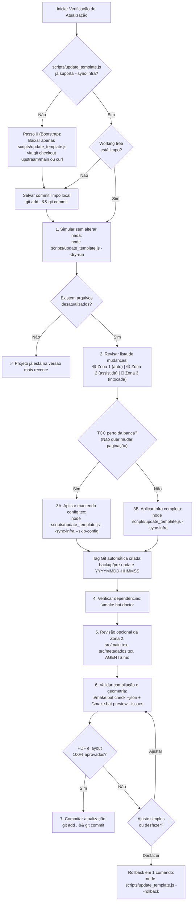

# 🔄 Guia Seguro de Atualização do Template TCC IFS (Humanos & IAs)

Este guia documenta o protocolo oficial para atualizar qualquer projeto criado a partir de uma versão anterior do **[template-tcc-ifs-latex](https://github.com/JGustavoCN/template-tcc-ifs-latex)** — inclusive repositórios criados via botão **"Use this template"** no GitHub (com histórico Git independente) e projetos que possuem capítulos extras, `resources/`, `docs/guias/`, `docs/pdfs/` ou `cache/` — **sem risco de perder uma única linha escrita do seu TCC**.

---

## 🛡️ O Modelo de 3 Zonas (`template-manifest.json`)

Toda atualização obedece estritamente às 3 zonas declaradas em [`template-manifest.json`](../template-manifest.json):

| Zona | O que contém | Comportamento do `--sync-infra` |
| :--- | :--- | :--- |
| **🟢 Zona 1 — Infraestrutura Pura** | `scripts/*`, `web/template.html`, `Makefile`, `make.bat`, `.gitattributes`, `.github/workflows/*`, `src/config.tex` *(opcional com `--skip-config`)*, `slides/tema-ifs.sty`, `CHECKLIST_DEFESA.md`, `.agents/rules/mcp_gdocs.md`, `.agents/skills/*`, `template-manifest.json` | Atualizada automaticamente a partir de `upstream/main` após criar tag de backup. |
| **🟡 Zona 2 — Híbrida / Assistida** | `src/main.tex`, `src/metadados.tex`, `.gitignore`, `AGENTS.md`, `GEMINI.md`, `README.md`, `slides/apresentacao.tex` | **NUNCA sobrescrita cegamente.** O `.gitignore` recebe apenas *append* idempotente de regras novas (mantendo regras locais como `cache/`); `slides/apresentacao.tex` só é criado se não existir; `main.tex` e `metadados.tex` recebem relatório de migração assistida. |
| **🔴 Zona 3 — Sagrada / Autoral** | `src/capitulos/**`, `src/pre-textuais.tex`, `src/referencias.bib`, `src/apendices/**`, `src/anexos/**`, `src/figuras/**`, `docs/pdfs/**`, `docs/guias/**`, `resources/**`, `cache/**`, `example/**` | **PROIBIÇÃO ABSOLUTA** de sobrescrita, limpeza ou remoção. |

---

## ⚡ Passo 0 (Bootstrap) — Para Projetos em Versões Antigas (< v2.5.0)

Se o seu projeto foi criado antes da **v2.5.0**, o arquivo `scripts/update_template.js` local ainda é a versão antiga (que só conhece `--merge` e não possui `--sync-infra`, `--dry-run`, `--skip-config` nem `--rollback`).

**Antes de rodar o fluxo completo, baixe apenas o novo script `scripts/update_template.js`** (isso não toca em nenhum outro arquivo do seu TCC):

### Opção A — Via Git (Recomendado)
```bash
# 1. Garanta que suas alterações locais estão salvas em commit:
git status

# 2. Conecte o repositório oficial (se ainda não existir 'upstream'):
git remote add upstream https://github.com/JGustavoCN/template-tcc-ifs-latex.git

# 3. Baixe SOMENTE o novo atualizador do upstream:
git fetch upstream main
git checkout upstream/main -- scripts/update_template.js
```

### Opção B — Via PowerShell (Windows) ou `curl` (Linux/macOS)
```powershell
# Windows (PowerShell):
Invoke-WebRequest -Uri "https://raw.githubusercontent.com/JGustavoCN/template-tcc-ifs-latex/main/scripts/update_template.js" -OutFile "scripts/update_template.js"
```
```bash
# Linux / macOS:
curl -fsSL "https://raw.githubusercontent.com/JGustavoCN/template-tcc-ifs-latex/main/scripts/update_template.js" -o scripts/update_template.js
```

> **Confirmação rápida:** rode `node scripts/update_template.js --help`. Se aparecer `--sync-infra`, `--dry-run` e `--rollback`, o bootstrap está pronto! (Antes de rodar `--sync-infra`, faça commit do novo script ou rode `--dry-run` primeiro.)

---

## 🧭 Fluxograma Completo da Atualização Segura



---

## 🛠️ Passo a Passo Operacional

### 1. Salve seu trabalho atual (Obrigatório)
Nunca atualize com arquivos sem commit:
```bash
git add .
git commit -m "chore: snapshot antes de atualizar template"
```

### 2. Simule a atualização sem tocar em nada (`--dry-run`)
```bash
node scripts/update_template.js --dry-run
# Ou para consumo estruturado por IA:
node scripts/update_template.js --dry-run --json
```
O comando exibirá:
- Sua versão local vs. versão oficial (`upstream/main`);
- Se o histórico Git é compartilhado ou independente (*Use this template*);
- A lista exata de arquivos da **Zona 1** que serão atualizados/criados;
- As linhas novas que serão acrescentadas ao `.gitignore` (sem apagar regras locais como `cache/`);
- Pendências opcionais da **Zona 2** (`src/main.tex`, `src/metadados.tex`);
- Todos os diretórios autorais da **Zona 3** que permanecerão intocados.

### 3. Aplique a atualização da infraestrutura (`--sync-infra`)
- **Em uma branch isolada (máxima segurança — mantém sua branch principal intocada até você testar):**
  ```bash
  node scripts/update_template.js --sync-infra --branch
  ```
- **Direto na branch atual (com tag de backup automática):**
  ```bash
  node scripts/update_template.js --sync-infra
  ```
- **Modo conservador perto da banca (preserva `src/config.tex` e paginação atual):**
  ```bash
  node scripts/update_template.js --sync-infra --branch --skip-config
  ```
O script cria automaticamente uma tag Git `backup/pre-update-YYYYMMDD-HHMMSS` e grava a lista exata de arquivos novos em `.git/template-update-last.json` antes de modificar qualquer arquivo. Se você rodar `--rollback`, ele restaura a tag, remove **somente** os arquivos novos criados pelo update (sem nunca tocar em arquivos seus) e, caso tenha usado `--branch`, retorna automaticamente à sua branch original!

### 4. Migração Assistida da Zona 2 (Opcional)
Se o relatório da Zona 2 indicar recursos novos ausentes no seu projeto antigo, você (ou a IA, com sua autorização) pode ativá-los pontualmente sem perder seus capítulos:

- **`src/metadados.tex` (se quiser usar Folha de Aprovação automática):**
  ```latex
  \orientadorinstituicao{Instituto Federal de Educação, Ciência e Tecnologia de Sergipe -- IFS}
  \dataaprovacao{Lagarto -- SE, \underline{\hspace{1cm}} de \underline{\hspace{3cm}} de 2026.}
  \bancaum{Prof. Dr. Avaliador Um}
  \bancauminstituicao{Instituto Federal de Educação, Ciência e Tecnologia de Sergipe -- IFS}
  \bancadois{Prof. Me. Avaliador Dois}
  \bancadoisinstituicao{Instituto Federal de Educação, Ciência e Tecnologia de Sergipe -- IFS}
  ```
- **`src/main.tex` (somente se desejar ativar Ficha Catalográfica, Folha de Aprovação ou Lista de Quadros):**
  ```latex
  % Logo após \imprimirfolhaderosto:
  % \inserirfichacatalografica{figuras/ficha-catalografica.pdf}
  \imprimirfolhadeaprovacao

  % Entre \listoffigures* e \listoftables*:
  \pdfbookmark[0]{\listofquadrosname}{loq}
  \listofquadros*
  \cleardoublepage
  ```

### 5. Valide Ambiente, Build e Geometria
```bash
.\make.bat doctor            # Linux/Mac: make doctor
.\make.bat check             # Linux/Mac: make check (auto-build + flutuadores + geometria do PDF)
.\make.bat preview --issues  # Se houver qualquer aviso, inspecione em PNG
```

### 6. Confirme no Git ou Desfaça em 1 Comando
- **Tudo certo:**
  ```bash
  git diff --stat
  git add .
  git commit -m "chore(template): sincroniza infraestrutura do template oficial"
  ```
- **Quer voltar exatamente ao estado anterior:**
  ```bash
  node scripts/update_template.js --rollback
  ```
