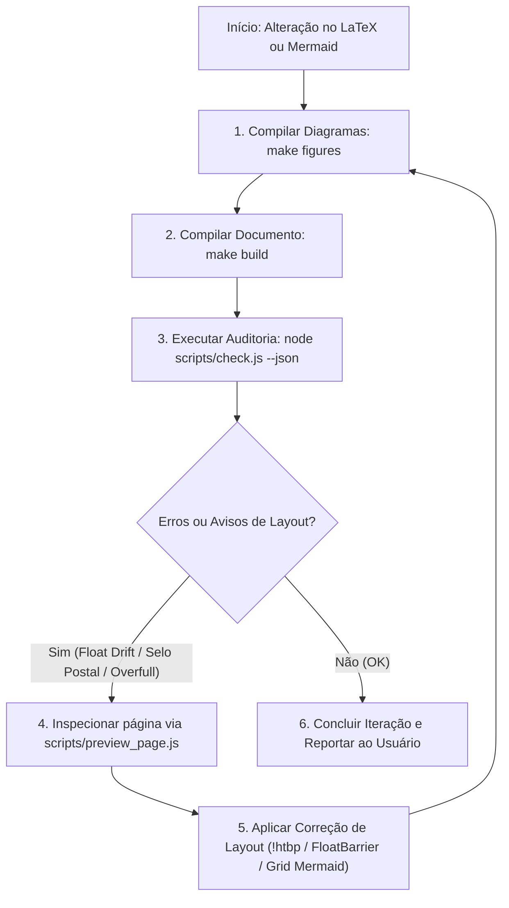

# Guia de Melhorias do Template TCC IFS: Diagnóstico Automatizado de Diagramação, Flutuadores e PDF

Este documento estabelece as diretrizes arquiteturais, o histórico de lições aprendidas e o ecossistema de scripts automatizados desenvolvidos para garantir que o **template LaTeX do TCC (IFS)** e os **agentes de Inteligência Artificial (Antigravity)** diagnostiquem e resolvam problemas de diagramação, represamento de tabelas e visualização de diagramas com rapidez e precisão matemática.

---

## 🎯 1. O Problema Histórico e a Lição Aprendida (Chat `6f06c0ed`)

Em 19 de outubro de 2026, durante a elaboração do TCC, foi identificado um comportamento anômalo silencioso na diagramação do documento:
1. **Represamento em Cascata (*Float Congestion*):**
   * A partir do **Quadro 15** (na Seção 4.5), uma tabela densa com decisões arquiteturais ocupava cerca de 80% da altura útil da página. O LaTeX rejeitou alocá-la na mesma folha em que a seção começava.
   * O LaTeX utiliza uma fila estritamente sequencial (*First-In, First-Out* — FIFO) para elementos flutuantes do mesmo tipo (`table`). Se uma tabela é rejeitada para a próxima página e a página seguinte não possui espaço suficiente, ela fica na fila de espera (*float queue*).
   * **Consequência Silenciosa:** Todas as tabelas posteriores (**Tabelas 16, 17, 18, 19, 20 e 21**) foram impedidas de aparecer, sendo acumuladas e descarregadas em bloco no final do capítulo, gerando **5 páginas consecutivas apenas de tabelas desconectadas do texto** (páginas 64 a 68 do documento).
   * **O Problema da IA:** O compilador `pdflatex` **não gera erro fatal** quando isso ocorre. O log acusava apenas compilação bem-sucedida, deixando a IA "cega" se ela apenas verificasse mensagens de erro textuais.
2. **Diagramas Mermaid Ilegíveis (Efeito "Selo Postal"):**
   * O fluxograma do procedimento experimental ([src/figuras/procedimento_experimental.mmd](file:///c:/Projetos/latex/project-tcc/src/figuras/procedimento_experimental.mmd)) foi estruturado inicialmente como uma longa cadeia vertical única (`flowchart TD` com 14 nós sequenciais), resultando em uma proporção geométrica desfavorável de **1:7** (largura estreita e altura enorme).
   * Ao ser incluído no LaTeX com uma trava rígida de altura (`height=10.5cm`), o compilador reduziu a largura para apenas ~2,2 cm no centro da página A4, tornando as fontes microscópicas e ilegíveis.
3. **Empilhamento Conflitante de Figuras:**
   * O Diagrama de Casos de Uso (Figura 3) e o Diagrama de Sequência (Figura 4) disputavam a mesma página, forçando uma redução drástica de escala e quebrando a explicação dos fluxos no rodapé da folha.

---

## 🛠️ 2. Soluções Estruturais Incorporadas ao Template

Para sanar essas vulnerabilidades de forma definitiva, o template foi atualizado com três camadas de proteção:

### Camada 1: Preâmbulo do LaTeX ([src/config.tex](file:///c:/Projetos/latex/project-tcc/src/config.tex))
* **Pacote `placeins` com barreira automática de seção:**
  ```latex
  \usepackage[section]{placeins}
  ```
  Obriga o LaTeX a descarregar todos os flutuadores pendentes antes de iniciar um novo `\section`, impedindo vazamento de tabelas para seções posteriores.
* **Calibração de Parâmetros de Ocupação de Página:**
  ```latex
  \renewcommand{\topfraction}{0.85}       % Permite que tabelas ocupem até 85% do topo (padrão: 0.70)
  \renewcommand{\bottomfraction}{0.70}    % Permite floats ocuparem até 70% do rodapé
  \renewcommand{\textfraction}{0.15}      % Exige apenas 15% de texto mínimo em páginas mistas (padrão: 0.20)
  \renewcommand{\floatpagefraction}{0.70} % Facilita páginas dedicadas apenas a tabelas grandes
  \setcounter{topnumber}{3}               % Permite até 3 flutuadores no topo
  \setcounter{bottomnumber}{2}            % Permite até 2 flutuadores na base
  \setcounter{totalnumber}{5}             % Máximo de 5 flutuadores por página
  ```

### Camada 2: Padrão de Declaração de Flutuadores nos Capítulos
* **Especificador Assertivo `[!htbp]`:**
  Toda tabela ou figura densa deve utilizar `\begin{table}[!htbp]` ou `\begin{figure}[!htbp]`. O ponto de exclamação instrui o compilador a ignorar restrições secundárias de espaçamento antes de rejeitar o flutuador para a fila.
* **Barreiras Manuais de Sincronização (`\FloatBarrier` e `\clearpage`):**
  * Quando uma subseção possui tabelas muito densas (ex: Quadro 15 e Tabela 16), insere-se `\FloatBarrier` antes do início do próximo tópico.
  * Quando uma subseção possui um diagrama amplo acompanhado de sua análise descritiva em múltiplos tópicos (ex: Diagrama de Sequência com Fases 1, 2 e 3), utiliza-se `\clearpage` antes da subseção para garantir uma página dedicada onde diagrama e texto convivam harmonicamente.

### Camada 3: Padrão Panorâmico para Diagramas Mermaid (`.mmd`)
* **Evite tiras verticais estreitas (`flowchart TD` longo sem subgrafos).**
* **Adote Layouts em 2 Colunas ou Grid 2x2:**
  Divida fluxos longos em subgrafos temáticos dispostos lado a lado.
  *Exemplo de arquitetura aplicada no `procedimento_experimental.mmd`:*
  ```mermaid
  flowchart LR
    subgraph E1["Etapa Inicial: Planejamento e Calibração"]
      direction TB
      F1["Fase 1: Preparação"] --> F2["Fase 2: Calibração (Piloto)"]
    end
    subgraph E2["Etapa Final: Execução e Análise"]
      direction TB
      F3["Fase 3: Coleta Sistemática"] --> F4["Fase 4: Avaliação Analítica"]
    end
    E1 --> E2
  ```
* Essa estrutura gera PDFs vetoriais com proporção áurea (proporção de aspecto próxima a 16:9 ou 3:2), ocupando a largura total `\textwidth` com tipografia nítida e confortável.

---

## 🧰 3. Novo Subsistema de Diagnóstico Automatizado

Para que nem o autor nem a IA precisem "adivinhar" o que aconteceu no PDF, foram criados e integrados novos utilitários em [scripts/](file:///c:/Projetos/latex/project-tcc/scripts):

### 1. Auditoria Integrada via `scripts/check.js` (ou `make.bat check`)
O verificador agora possui o módulo [scripts/lib/layout_inspector.js](file:///c:/Projetos/latex/project-tcc/scripts/lib/layout_inspector.js), que inspeciona automaticamente:

1. **Mapeamento de Flutuadores vs. Código:**
   * Lê `src/build/main.aux` e extrai a página exata de impressão de cada `tab:`, `quadro:` e `fig:`.
   * Cruza com os arquivos `.tex` para identificar a seção de origem, a linha de declaração e o especificador utilizado.
2. **Detecção de *Float Drift* (Represamento):**
   * Compara a página onde o elemento foi referenciado/declarado com a página onde ele realmente foi impresso.
   * Se uma tabela foi empurrada para além de sua seção ou mais de 3 páginas à frente, emite alerta de **REPRESAMENTO** com sugestão de `\FloatBarrier`.
3. **Detecção de Efeito "Selo Postal" nas Figuras:**
   * Lê as dimensões do `/MediaBox` diretamente dos PDFs em `src/figuras/`.
   * Se a altura for mais de 2.2x maior que a largura (proporção vertical extrema), emite alerta precoce avisando que a figura ficará microscópica no LaTeX.
4. **Auditoria do Preâmbulo:**
   * Valida se `placeins` está ativo com `[section]`, se `\topfraction >= 0.85` e se o pacote incompatível `caption` não foi inserido acidentalmente.

#### Comandos Disponíveis:
```bash
# Diagnóstico completo interativo (Build + Layout/PDF + ABNT/Redação)
.\make.bat check
# ou
node scripts/check.js

# Exibe o catálogo completo de todas as tabelas e figuras e suas páginas no PDF
.\make.bat check --floats
# ou
node scripts/check.js --floats

# Saída estruturada em JSON (ideal para agentes de IA)
node scripts/check.js --json
```

---

### 2. Utilitário de Pré-Visualização Rápida de Páginas: `scripts/preview_page.js`
Permite que o Agente ou o desenvolvedor converta páginas específicas do PDF compilado em imagens PNG de alta resolução instantaneamente, sem precisar rodar comandos complexos de terminal:

```bash
# Renderiza páginas específicas (ex: página 40, 47 e 68)
.\make.bat preview 40 47 68
# ou
node scripts/preview_page.js 40 47 68

# Renderiza automaticamente todas as páginas que contêm tabelas e figuras
node scripts/preview_page.js --floats

# Renderiza um intervalo de páginas (ex: da página 45 à 52)
node scripts/preview_page.js --range 45-52
```

As imagens são salvas em `cache/previews/page_XXX.png` e o script imprime o link no formato `file:///...`, pronto para ser aberto pelo IDE ou inspecionado visualmente pelo Agente via `view_file`.

---

## 🤖 4. Protocolo Operacional para Agentes de IA (Antigravity)

Sempre que atuar neste repositório realizando alterações de texto, adicionando tabelas, incluindo novos requisitos ou diagramando figuras, a IA deve seguir este protocolo rigoroso:



### Regras de Ouro de Autonomia para Layout:
1. **Pode aplicar de forma autônoma:**
   * Ajustar especificadores `[htb]` ou `[htbp]` para `[!htbp]`.
   * Inserir comandos de sincronização `\FloatBarrier` ou `\clearpage` antes de seções ou subseções.
   * Redesenhar arquivos `.mmd` em `src/figuras/` para converter tiras verticais estreitas em layouts balanceados de 2 colunas ou grid 2x2.
   * Ajustar parâmetros de `\includegraphics` (`width=\textwidth,keepaspectratio`).
2. **Exige aprovação explícita do autor:**
   * Deletar linhas de tabelas para fazê-las caber na folha.
   * Modificar textos ou suprimir parágrafos autorais.

---

## 📋 5. Checklist Pré-Banca de Diagramação e Integridade

Antes de considerar qualquer entrega ou versão final do TCC pronta para a banca avaliadora:

| Item | Critério de Aceitação | Verificação |
| :--- | :--- | :---: |
| **Erros de Compilação** | 0 erros fatais no `main.log`. | `make check` |
| **Citações e Referências** | 0 referências indefinidas (`\ref`) e 0 citações ausentes (`\cite`). | `make check` |
| **Represamento de Tabelas** | 0 flutuadores com *Float Drift* superior a 2 páginas da seção de origem. | `node scripts/check.js --floats` |
| **Legibilidade de Figuras** | Diagramas com relação de aspecto equilibrada (< 2.2:1) e texto perfeitamente legível. | `node scripts/preview_page.js --floats` |
| **Conformidade ABNT** | Todas as figuras e tabelas com `\caption`, `\label` e `\fonte`. | `make check` |
| **Ausência de Linhas Órfãs** | Subseções com listas iniciam e terminam sem quebras abruptas de meio de frase no rodapé. | `make preview [pags]` |
