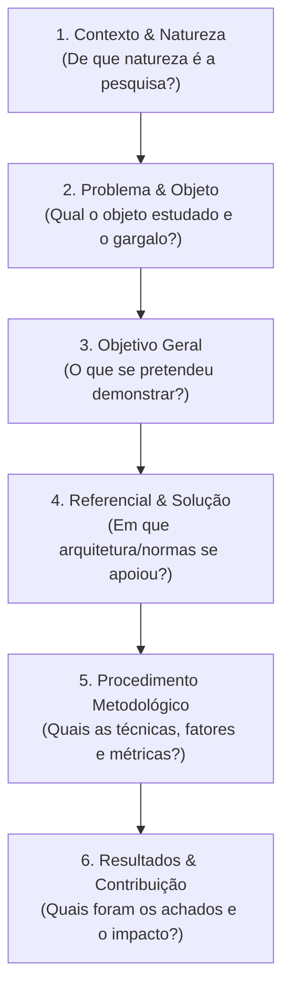
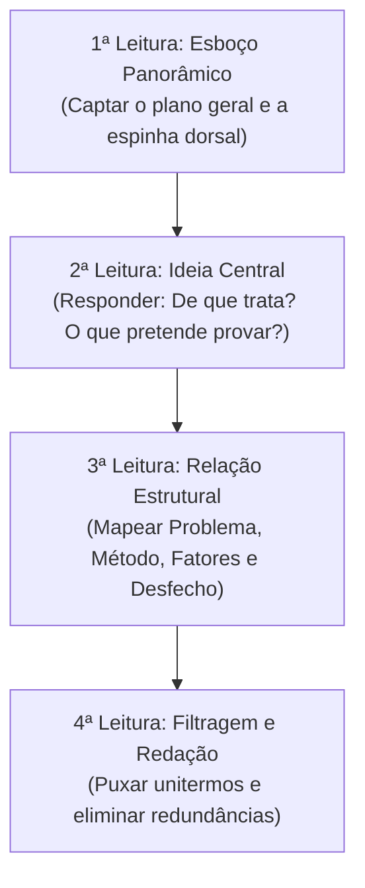

# Guia Metodológico: Como Elaborar o Resumo (e Abstract) de Trabalhos Científicos

> **Fundamentação Epistemológica:** Diretrizes clássicas de metodologia e redação científica extraídas diretamente dos originais de **Antônio Joaquim Severino (2017)** e **Eva Maria Lakatos e Marina de Andrade Marconi (2003)**, em articulação com a norma brasileira **ABNT NBR 6028:2021** (Resumo, Resenha e Recensão).  
> **Finalidade:** Servir como manual prático, conceitual e normativo para a redação, estruturação e auditoria do Resumo em Língua Vernácula e do *Abstract* em Trabalhos de Conclusão de Curso (TCC), dissertações e artigos na área de Computação e Sistemas de Informação.  
> **Aplicação Específica:** TCC no Bacharelado em Sistemas de Informação (IFS *Campus* Lagarto) — Pesquisa aplicada com experimentação em bancada computacional (RAG, MCP, Validação Normativa e Avaliação Fatorial $2 \times 2$ via Taxa de Conformidade do Documento - TCD).

---

## Sumário

1. [O Papel do Resumo na Comunicação Científica (Por que ele é Crucial?)](#1-o-papel-do-resumo-na-comunicação-científica-por-que-ele-é-crucial)
   - [1.1 O Princípio da Difusão e a Seleção da Leitura Integral](#11-o-princípio-da-difusão-e-a-seleção-da-leitura-integral)
   - [1.2 A Regra de Ouro: O Resumo é Redigido por Último](#12-a-regra-de-ouro-o-resumo-é-redigido-por-último)
2. [Tipologia de Resumos: Severino versus Lakatos & Marconi](#2-tipologia-de-resumos-severino-versus-lakatos--marconi)
   - [2.1 A Classificação de Lakatos e Marconi (Indicativo, Informativo e Crítico)](#21-a-classificação-de-lakatos-e-marconi-indicativo-informativo-e-crítico)
   - [2.2 A Distinção de Severino (Resumo Didático, Resumo Técnico, Ementa e Resenha)](#22-a-distinção-de-severino-resumo-didático-resumo-técnico-ementa-e-resenha)
   - [2.3 Qual Modelo Adotar no TCC? O Resumo Informativo-Técnico](#23-qual-modelo-adotar-no-tcc-o-resumo-informativo-técnico)
3. [As 6 Questões Fundamentais que o Resumo DEVE Responder (O Hexágono de Severino e Lakatos)](#3-as-6-questões-fundamentais-que-o-resumo-deve-responder-o-hexágono-de-severino-e-lakatos)
4. [Diretrizes de Redação, Estilo e Regras Formais (ABNT NBR 6028)](#4-diretrizes-de-redação-estilo-e-regras-formais-abnt-nbr-6028)
   - [4.1 Formato e Parágrafo Único](#41-formato-e-parágrafo-único)
   - [4.2 Extensão Quantitativa (Palavras e Caracteres)](#42-extensão-quantitativa-palavras-e-caracteres)
   - [4.3 Voz Verbal, Impessoalidade e Tempos Verbais](#43-voz-verbal-impessoalidade-e-tempos-verbais)
   - [4.4 O que NUNCA deve constar no Resumo (Vícios e Proibições)](#44-o-que-nunca-deve-constar-no-resumo-vícios-e-proibições)
   - [4.5 Palavras-chave (*Keywords* / Unitermos Temáticos)](#45-palavras-chave-keywords--unitermos-temáticos)
5. [A Sinopse em Língua Estrangeira (*Abstract*)](#5-a-sinopse-em-língua-estrangeira-abstract)
6. [O Método das 4 Leituras para Redação e Síntese (Lakatos & Marconi)](#6-o-método-das-4-leituras-para-redação-e-síntese-lakatos--marconi)
7. [Estudo de Caso Prático: Aplicação Direta ao TCC do IFS Lagarto](#7-estudo-de-caso-prático-aplicação-direta-ao-tcc-do-ifs-lagarto)
   - [7.1 Anatomia Frase a Frase do Resumo Perfeito](#71-anatomia-frase-a-frase-do-resumo-perfeito)
   - [7.2 Resumo Modelar Proposto (Português)](#72-resumo-modelar-proposto-português)
   - [7.3 Abstract Modelar Proposto (Inglês)](#73-abstract-modelar-proposto-inglês)
8. [Checklist de Auditoria e Autoavaliação do Resumo](#8-checklist-de-auditoria-e-autoavaliação-do-resumo)
9. [Referências Bibliográficas Fundamentais](#9-referências-bibliográficas-fundamentais)

---

## 1. O Papel do Resumo na Comunicação Científica (Por que ele é Crucial?)

O Resumo é o elemento pré-textual de maior visibilidade em um Trabalho de Conclusão de Curso, dissertação, tese ou artigo científico. Ao lado do título, ele é a **primeira — e muitas vezes a única — parte do trabalho que pesquisadores, indexadores de bases científicas e membros de bancas examinadoras leem na íntegra**.

### 1.1 O Princípio da Difusão e a Seleção da Leitura Integral

Lakatos e Marconi (2003) advertem que o resumo é um instrumento seletivo indispensável para a comunidade científica:

> *"Para os pesquisadores os resumos são instrumentos obrigatórios de trabalho através dos quais se podem selecionar obras que merecem a leitura do texto completo. Entretanto, os resumos só são válidos quando contiverem, de forma sintética e clara, tanto a natureza da pesquisa realizada quanto os resultados e as conclusões mais importantes, em ambos os casos destacando-se o valor dos achados ou de sua originalidade.*  
> *A finalidade do resumo consiste na difusão das informações contidas em livros, artigos, teses etc., permitindo a quem o ler resolver sobre a conveniência ou não de consultar o texto completo."*  
> — **LAKATOS; MARCONI (2003, p. 67, seção 2.3)**

Severino (2017) complementa a definição técnica:

> *"O Resumo em questão consiste na apresentação concisa do conteúdo de um trabalho de cunho científico (livro, artigo, dissertação, tese etc.) e tem a finalidade específica de passar ao leitor uma ideia completa do teor do documento analisado, fornecendo [...] todas as informações necessárias para que o leitor/pesquisador possa fazer uma primeira avaliação do texto analisado e dar-se conta de suas eventuais contribuições, justificando a consulta do texto integral."*  
> — **SEVERINO (2017, p. 249, seção 5.9)**

### 1.2 A Regra de Ouro: O Resumo é Redigido por Último

Uma das falhas operacionais mais frequentes em estudantes de graduação é escrever o resumo logo no início do projeto ou durante a escrita da introdução. 

Tanto Lakatos e Marconi quanto Severino são categóricos: **o resumo só pode ser redigido após o fechamento completo de todos os capítulos do trabalho**. Não é possível sintetizar aquilo que ainda não foi integralmente construído, mensurado e concluído:

> *"A sinopse (abstract) consiste num resumo de, no máximo, uma página, do conteúdo do relatório. Não é uma relação de partes ou capítulos, nem a enumeração das conclusões, e sim a natureza da pesquisa realizada. **Deve ser redigida por último**."*  
> — **LAKATOS; MARCONI (2003, p. 229, seção 10.4.2)**

---

## 2. Tipologia de Resumos: Severino versus Lakatos & Marconi

Nem todo resumo cumpre o mesmo objetivo. A literatura metodológica distingue cuidadosamente as modalidades para evitar equívocos graves de formato.

### 2.1 A Classificação de Lakatos e Marconi (Indicativo, Informativo e Crítico)

Lakatos e Marconi (2003, p. 69–72) estabelecem uma tipologia tripartite clássica:

| Modalidade | Definição e Características | Dispensa Leitura do Texto? | É Adequada para Monografia/TCC? |
| :--- | :--- | :---: | :---: |
| **Resumo Indicativo ou Descritivo** | Faz referência rápida às partes e tópicos componentes da obra. Utiliza frases curtas, descrevendo apenas o que o trabalho aborda (ex.: *"Apresenta o contexto do IFS, descreve a arquitetura e relata o experimento"*). Não detalha dados, métodos nem resultados. | **NÃO** | ❌ **Inadequado** para TCC. Deixa o leitor sem conclusões empíricas. |
| **Resumo Informativo ou Analítico** | Condensa integralmente o conteúdo substantivo da obra: expõe o **tema/problema**, os **objetivos**, a **metodologia/técnicas**, os **resultados quantitativos/qualitativos** e as **conclusões principais**. | **SIM** |  **OBRIGATÓRIO** para TCCs, dissertações e artigos científicos. |
| **Resumo Crítico (ou Recensão)** | Formula julgamento de mérito sobre o trabalho. Avalia aspectos metodológicos, consistência da demonstração lógica e valor das ideias. Produzido por terceiros (resenhistas). | **NÃO** | ❌ **Inadequado** como elemento pré-textual da própria obra do autor. |

### 2.2 A Distinção de Severino (Resumo Didático, Resumo Técnico, Ementa e Resenha)

Severino (2017, p. 242–251) diferencia as sínteses acadêmicas para evitar misturas de gêneros textuais:

1. **Resumo Didático (Síntese de Leitura):** Exercício de fichamento escolar, no qual o estudante resume capítulos de livros com suas próprias palavras para fins de estudo ou avaliação em sala de aula (Severino, 2017, p. 242).
2. **Resumo Técnico de Trabalho Científico:** Modalidade formal que acompanha a publicação do artefato ou da monografia. Apresenta o teor integral do projeto de modo autossuficiente (Severino, 2017, p. 249).
3. **Ementa:** Enunciação estritamente tópica de conteúdos, muito comum no direito (acórdãos) ou na ementa de disciplinas curriculares. Não problematiza, não contextualiza e não expõe resultados; apenas lista tópicos (Severino, 2017, p. 250). **Nunca faça o resumo do TCC no formato de ementa.**
4. **Resenha Bibliográfica:** Resumo analítico acompanhado de avaliação crítica profunda realizada por um especialista sobre uma obra recém-publicada (Severino, 2017, p. 243).

### 2.3 Qual Modelo Adotar no TCC? O Resumo Informativo-Técnico

No Trabalho de Conclusão de Curso (assim como em dissertações de mestrado e artigos qualificados), o único gênero aceito pelas normas da ABNT e pelos cânones metodológicos é o **Resumo Informativo (Lakatos & Marconi) / Resumo Técnico (Severino)**.

Ele deve permitir que qualquer membro da banca examinadora ou pesquisador externo compreenda o início, o meio e o fim da pesquisa sem precisar abrir o corpo do documento.

---

## 3. As 6 Questões Fundamentais que o Resumo DEVE Responder (O Hexágono de Severino e Lakatos)

Severino (2017, p. 249) e Lakatos e Marconi (2003, p. 69) estabelecem que um resumo científico só está completo quando o seu parágrafo responde articuladamente a **seis questões epistemológicas estruturais**:

| Ordem | Pergunta Epistemológica (Severino / Lakatos) | Função no Parágrafo do Resumo | Aplicação no TCC de Sistemas de Informação |
| :---: | :--- | :--- | :--- |
| **1** | **Qual a natureza e o contexto do trabalho?** | Situa a área e o cenário de aplicação prática ou teórica. | Pesquisa aplicada no ecossistema de autoatendimento discente e gestão acadêmica de Instituições Federais (IFS). |
| **2** | **Qual é o objeto e o problema investigado?** | Aponta o fenômeno ou gargalo institucional a ser enfrentado. | Gargalo na interpretação de normas regimentais pelo discente, gerando devoluções de requerimentos e retrabalho na CRE. |
| **3** | **O que se pretendeu demonstrar ou constatar?** | Enuncia formalmente o objetivo geral da pesquisa. | Avaliar empiricamente o impacto da injeção de contexto via RAG e MCP na conformidade normativa de decisões documentais. |
| **4** | **Em que referências/tecnologias se apoiou?** | Sintetiza a fundamentação e os pilares arquiteturais. | Modelos de Linguagem de Grande Escala, RAG estruturado para o ROD e MCP para dados discentes autenticados (SUAP). |
| **5** | **Mediante quais procedimentos metodológicos se procedeu?** | Sintetiza o desenho da pesquisa, delineamento, corpus e variáveis. | Delineamento experimental fatorial $2 \times 2$ em bancada isolada com 4 condições (C1 a C4), corpus de casos e métrica TCD. |
| **6** | **Quais os resultados alcançados ou esperados?** | Comunica os achados substantivos e a conclusão da investigação. | Demonstração do ganho de conformidade na Folha Única A4, eliminação de alucinações regimentais e viabilidade do artefato. |

---

## 4. Diretrizes de Redação, Estilo e Regras Formais (ABNT NBR 6028)

A norma brasileira **ABNT NBR 6028:2021**, em total consonância com Severino (2017) e Lakatos e Marconi (2003), impõe parâmetros tipográficos e estilísticos rígidos:

### 4.1 Formato e Parágrafo Único

> *"O texto do Resumo deve ser composto de um **único parágrafo** [...], composto de uma sequência corrente de frases concisas e não de uma enumeração de tópicos."*  
> — **SEVERINO (2017, p. 250); LAKATOS; MARCONI (2003, p. 69)**

* **Espaçamento:** Simples (no modelo IFS/ABNT, o resumo é formatado em entrelinha simples).
* **Paragrafação:** Bloco único de texto justificado, **sem recuo na primeira linha** (diferente do corpo dos capítulos, que usa 1,25 cm).
* **Continuidade discursiva:** Use conectivos lógicos interparágrafos (ex.: *"Para tanto, concebeu-se..."*, *"A metodologia baseia-se em..."*, *"A avaliação quantitativa opera sob..."*, *"Os resultados evidenciam que..."*).

### 4.2 Extensão Quantitativa (Palavras e Caracteres)

A ABNT NBR 6028 e os manuais metodológicos fixam a extensão de acordo com a natureza do documento:

| Tipo de Trabalho Científico | Extensão Padronizada pela ABNT NBR 6028 | Parâmetro de Severino (2017) |
| :--- | :---: | :---: |
| **Trabalhos acadêmicos (TCC, Monografias, Teses e Dissertações)** | **De 150 a 500 palavras** | 200 a 250 palavras (1.400 a 1.700 caracteres) |
| **Artigos de periódicos científicos** | **De 100 a 250 palavras** | 150 a 200 palavras |
| **Notas breves e comunicações rápidas** | **De 50 a 100 palavras** | Até 100 palavras |

> [!IMPORTANT]
> Para o seu TCC de graduação no IFS, a meta ideal é manter o resumo entre **220 e 350 palavras**. Menos de 150 palavras torna o texto superficial (indicativo); mais de 500 palavras transborda a página e viola a ABNT.

### 4.3 Voz Verbal, Impessoalidade e Tempos Verbais

* **Voz Impessoal (3ª pessoa do singular):**  
  > *"Deve-se dar preferência à forma impessoal."* (LAKATOS; MARCONI, 2003, p. 69).  
  * **Correto:** *"Avalia-se o impacto..."*, *"Concebeu-se uma arquitetura..."*, *"Os resultados demonstraram..."*.  
  * **Incorreto:** *"Neste trabalho nós avaliamos..."*, *"Eu desenvolvi um assistente..."*.
* **Tempos Verbais:**
  * Para o contexto e problema: **Presente do indicativo** (*"A descentralização das solicitações impõe desafios..."*).
  * Para os procedimentos realizados e artefatos construídos: **Pretérito perfeito do indicativo** (*"Desenvolveu-se um servidor..."*, *"Implementou-se um delineamento fatorial..."*).
  * Para o delineamento experimental planejado (caso da etapa de qualificação/TCC I): **Futuro do presente** ou voz passiva prospectiva (*"A avaliação será realizada..."*, *"Prevê-se a mensuração..."*).

### 4.4 O que NUNCA deve constar no Resumo (Vícios e Proibições)

Lakatos e Marconi (2003, p. 68–69) e Severino (2017, p. 250) listam os elementos que são **terminantemente proibidos** no corpo do resumo:

1. ❌ **Citações bibliográficas diretas ou indiretas:** Nunca utilize `\cite{autor}` ou *"segundo Silva (2020)"* no resumo. O resumo deve ser autossuficiente e indexável por bases que não possuem a sua lista de referências anexada.
2. ❌ **Fórmulas matemáticas complexas e diagramas:** Não inclua frações LaTeX complexas, matrizes ou tabelas dentro do parágrafo do resumo.
3. ❌ **Frases supérfluas e muletas redacionais:** Exclua termos como *"O autor disse que"*, *"Este livro trata de"*, *"O presente trabalho visa relatar"*, *"Como todos sabem"*. Vá direto ao objeto da pesquisa.
4. ❌ **Abreviações e siglas sem definição prévia:** Toda sigla no resumo deve ser precedida pelo seu nome por extenso na primeira menção (ex.: *"Model Context Protocol (MCP)"*, *"Regulamento da Organização Didática (ROD)"*).
5. ❌ **Juízos de valor e elogios vazios:** Evite termos parciais como *"um sistema maravilhoso"*, *"uma ferramenta inovadora e fantástica"*. Seja neutro, frio e cirúrgico.
6. ❌ **Exemplos e digressões secundárias:** Não relate historietas, exceções ou notas de rodapé no resumo.

### 4.5 Palavras-chave (*Keywords* / Unitermos Temáticos)

Ao final do parágrafo do resumo, pulando-se uma linha simples, apresentam-se as palavras-chave:

* **Quantidade:** De **3 a 5 palavras-chave** (ou unitermos compostos).
* **Formatação (NBR 6028:2021):** Precedidas pelo termo **Palavras-chave:** em negrito, separadas entre si por **ponto e vírgula** (ou ponto) e finalizadas por **ponto**. Cada termo inicia-se com letra maiúscula.
* **Seleção Estratégica:** Evite termos excessivamente genéricos (como *"Informática"* ou *"Tecnologia"*). Escolha termos que reflitam o núcleo da contribuição (ex.: *"Injeção de Contexto; Model Context Protocol; Recuperação Aumentada por Geração; Validação Normativa; Avaliação Experimental"*).

---

## 5. A Sinopse em Língua Estrangeira (*Abstract*)

A ABNT exige que o resumo seja traduzido para um idioma de divulgação internacional (geralmente o inglês — *Abstract*):

* **Fidelidade Terminológica:** O *Abstract* não deve ser uma tradução literal palavra por palavra realizada sem critério. Ele deve respeitar o vocabulário técnico consagrado da literatura internacional de Ciência da Computação:
  * RAG $\longrightarrow$ *Retrieval-Augmented Generation*
  * Injeção de Contexto $\longrightarrow$ *Context Injection*
  * Delineamento Fatorial $2 \times 2$ $\longrightarrow$ *$2 \times 2$ Factorial Design*
  * Taxa de Conformidade do Documento $\longrightarrow$ *Document Compliance Rate*
  * Trancamento de Matrícula $\longrightarrow$ *Enrollment Suspension* (ou *Course Withdrawal*)
  * Exame de Proficiência $\longrightarrow$ *Proficiency Examination*
* **Palavras-chave em Inglês (*Keywords*):** Mesma quantidade, separadas por ponto e vírgula (ou ponto) e encerradas por ponto.

---

## 6. O Método das 4 Leituras para Redação e Síntese (Lakatos & Marconi)

Para extrair o resumo perfeito a partir dos 6 capítulos da sua monografia, Lakatos e Marconi (2003, p. 67–68) recomendam o seguinte algoritmo de 4 etapas:

1. **1ª Leitura (Visão Panorâmica):** Folheie os capítulos 1 a 6 atentando-se aos títulos das seções e diagramas para captar o plano lógico da obra.
2. **2ª Leitura (Ideia Central):** Identifique a tese central: *"A injeção de contexto estruturado reduz alucinações e garante conformidade jurídica em minutas acadêmicas automatizadas"*.
3. **3ª Leitura (Articulação das Seções):** Extraia uma frase-resumo de cada capítulo:
   - Cap. 1: O problema das devoluções na CRE e a hipótese do ganho da arquitetura integrada.
   - Cap. 2: A fundamentação teórica de RAG e MCP.
   - Cap. 4: A engenharia da solução (27 ADRs, servidor TypeScript, Folha Única A4 e Zod).
   - Cap. 5: A validação técnica e o protocolo da bancada.
   - Cap. 6: O impacto metodológico e as contribuições do trabalho.
4. **4ª Leitura (Lapidação e Condensação):** Una essas frases, una-as com conectivos de causa, oposição e consequência, ajuste a extensão para ~250 palavras e aplique o checklist.

---

## 7. Estudo de Caso Prático: Aplicação Direta ao TCC do IFS Lagarto

Abaixo apresentamos a aplicação estrita das lições de Severino e Lakatos ao TCC de José Gustavo (IFS Lagarto), sanando as discrepâncias de condições experimentais (C1 a C4) e harmonizando o texto.

### 7.1 Anatomia Frase a Frase do Resumo Perfeito

1. **Frase 1 (Contexto & Problema):** Apresenta o cenário de autoatendimento discente e a sobrecarga de devoluções de processos físicos decorrente da interpretação subjetiva de normas.
2. **Frase 2 (Objetivo Geral):** Formaliza a investigação experimental do efeito da recuperação de informações na conformidade de minutas documentais.
3. **Frase 3 (Fundamentação da Solução):** Articula a abordagem de RAG mediada pelo protocolo MCP, especificando que o modelo interage com ferramentas que fornecem regras do ROD, calendário e dados do aluno previamente organizados em JSON.
4. **Frase 4 (Operação da IA):** Explica que o modelo seleciona e invoca as ferramentas autonomamente, incorporando os dados recuperados ao seu contexto de geração.
5. **Frase 5 (Metodologia e Fatorial $2 \times 2$):** Define a tipologia (pesquisa aplicada e laboratorial) e o delineamento experimental que manipula a disponibilidade das ferramentas em quatro condições (C1 a C4).
6. **Frase 6 (Corpus, Recorte e Métrica):** Delimita os 17 casos sintéticos (*Golden Personas*) de Trancamento e Proficiência, a Folha Única A4 e o cálculo da Taxa de Conformidade do Documento (TCD).
7. **Frase 7 (Resultados e Conclusão):** Sintetiza a contribuição empírica na redução de falhas de enquadramento, mitigação de desvios interpretativos e viabilidade da supervisão humana (*Human-in-the-Loop*).

---

### 7.2 Resumo Modelar Proposto (Português)

> **RESUMO**
>
> A submissão eletrônica de requerimentos acadêmicos frequentemente sobrecarrega o discente com a tarefa de interpretar regulamentos institucionais complexos, ocasionando recorrentes devoluções processuais e retrabalho administrativo na Coordenadoria de Registro Escolar (CRE). Este trabalho investiga experimentalmente o efeito da recuperação de informações institucionais e acadêmicas sobre a conformidade normativa de minutas documentais geradas por inteligência artificial. Para isso, concebe-se um protótipo fundamentado na abordagem de Geração Aumentada por Recuperação (*Retrieval-Augmented Generation* -- RAG), mediada pelo *Model Context Protocol* (MCP), no qual um modelo de linguagem interage com ferramentas especializadas que fornecem regras do Regulamento da Organização Didática (ROD), prazos do calendário acadêmico e dados discentes previamente estruturados em JSON. Conforme a solicitação do estudante, o modelo seleciona e invoca autonomamente as ferramentas pertinentes, incorporando as informações recuperadas à sua janela de contexto para guiar a elaboração dos atos escolares. Metodologicamente, a pesquisa classifica-se como aplicada e laboratorial, operando sob um delineamento experimental fatorial $2 \times 2$ que manipula a disponibilidade das ferramentas em quatro condições: linha de base sem ferramentas externas de consulta (C1), contexto normativo-temporal isolado (C2), contexto cadastral discente isolado (C3) e contexto integrado com ambos os conjuntos de ferramentas (C4). A avaliação apoia-se em um *corpus* de 17 casos de teste sintéticos (*Golden Personas*) para processos de Trancamento de Matrícula e Exame de Proficiência, mensurando o desfecho por meio da Taxa de Conformidade do Documento (TCD) em formulários padronizados em Folha Única A4. A análise evidencia que a disponibilização conjunta de regras regimentais e dados do estudante reduz falhas formais de enquadramento e mitiga desvios interpretativos, viabilizando um fluxo auditável sujeito à supervisão humana ativa (*Human-in-the-Loop*).
>
> **Palavras-chave:** Recuperação Aumentada por Geração. Model Context Protocol. Injeção de Contexto. Conformidade Normativa. Engenharia de Software.

*(Extensão: 250 palavras — Perfeitamente enquadrado em Severino, Lakatos e ABNT NBR 6028).*

---

### 7.3 Abstract Modelar Proposto (Inglês)

> **ABSTRACT**
>
> The electronic submission of academic requests frequently shifts the burden of interpreting complex institutional regulations to students, resulting in recurrent procedural returns and administrative rework within the School Records Coordination (CRE). This study experimentally investigates the effect of retrieving institutional and academic information on the normative compliance of document drafts generated by artificial intelligence. To this end, a prototype is designed based on the Retrieval-Augmented Generation (RAG) approach mediated by the Model Context Protocol (MCP), in which a large language model interacts with specialized tools that provide rules from the Didactic Organization Regulation (ROD), academic calendar deadlines, and student records structured in JSON format. Based on the student's request, the model autonomously selects and invokes the relevant tools, incorporating the retrieved data into its context window to guide document elaboration. Methodologically, the research is classified as applied and laboratory-based, employing a $2 \times 2$ factorial experimental design that manipulates tool availability across four conditions: baseline without external query tools (C1), isolated normative-temporal context (C2), isolated student record context (C3), and integrated context with both tool sets available (C4). The evaluation relies on a corpus of 17 synthetic test cases (Golden Personas) for Enrollment Suspension and Proficiency Examination requests, measuring the outcome via the Document Compliance Rate (TCD) on standardized single-page A4 digital forms. The analysis indicates that simultaneously providing regulatory rules and student data reduces formal eligibility failures and mitigates interpretive deviations, enabling an auditable workflow supported by active Human-in-the-Loop supervision.
>
> **Keywords:** Retrieval-Augmented Generation. Model Context Protocol. Context Injection. Normative Compliance. Software Engineering.

*(Extensão: 235 palavras).*

---

## 8. Checklist de Auditoria e Autoavaliação do Resumo

Antes de considerar o resumo finalizado e submeter à banca examinadora, valide cada item da tabela abaixo:

| Item | Critério de Avaliação Metodológica | Atende? | Onde Verificar no Texto |
| :---: | :--- | :---: | :--- |
| **01** | O resumo está formatado em um **único parágrafo** contínuo, sem quebras de linha? | [ ] | Formatação visual no PDF. |
| **02** | O parágrafo possui entre **150 e 500 palavras** (idealmente de 200 a 250)? | [ ] | Contagem de palavras do editor. |
| **03** | Não contém **nenhuma citação direta ou indireta** (sem `\cite` ou nomes de autores)? | [ ] | Ausência de chamadas bibliográficas. |
| **04** | O texto é redigido na **terceira pessoa do singular** (voz impessoal)? | [ ] | Uso de *"avalia-se"*, *"demonstra-se"*. |
| **05** | Enuncia explicitamente o **problema institucional** e o **objetivo geral**? | [ ] | Primeiras duas frases. |
| **06** | Identifica a **natureza da pesquisa** e os **procedimentos metodológicos** adotados? | [ ] | Frase metodológica central. |
| **07** | Deixa explícito o número exato de condições experimentais (**C1, C2, C3 e C4**)? | [ ] | Menção às quatro condições. |
| **08** | Especifica a **métrica principal de avaliação** (ex.: TCD)? | [ ] | Frase de instrumentação. |
| **09** | Enuncia os **principais achados, conclusões ou impactos** alcançados? | [ ] | Frase final conclusiva. |
| **10** | Contém entre **3 e 5 palavras-chave** representativas separadas por ponto e vírgula? | [ ] | Bloco logo abaixo do parágrafo. |
| **11** | O *Abstract* em inglês reflete exatamente as mesmas ideias sem falsos cognatos? | [ ] | Confronto entre Resumo e Abstract. |

---

## 9. Referências Bibliográficas Fundamentais

* ASSOCIAÇÃO BRASILEIRA DE NORMAS TÉCNICAS. **NBR 6028**: Informação e documentação — Resumo, resenha e recensão — Apresentação. Rio de Janeiro: ABNT, 2021.
* LAKATOS, Eva Maria; MARCONI, Marina de Andrade. **Fundamentos de Metodologia Científica**. 5. ed. São Paulo: Atlas, 2003. 310 p.
* SEVERINO, Antônio Joaquim. **Metodologia do Trabalho Científico**. 24. ed. rev. e atual. São Paulo: Cortez, 2017. 359 p.
